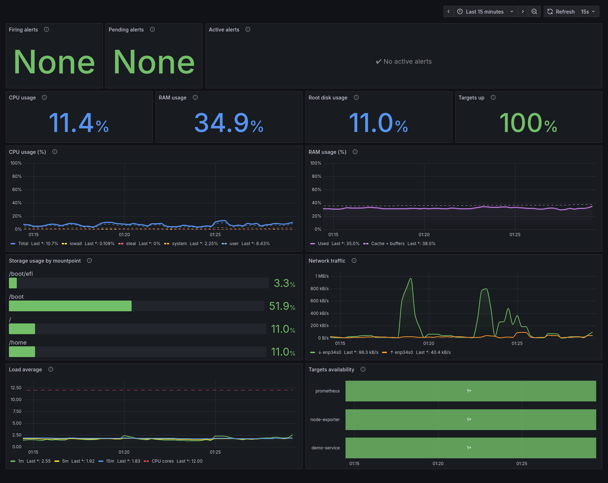
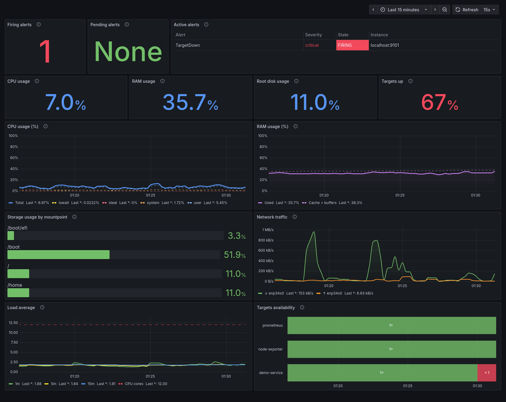

# InfraWatch

[](https://github.com/QueirozMoura/infrawatch/actions/workflows/ci.yml)
[](LICENSE)

InfraWatch is an open source monitoring and observability stack for Linux hosts. It collects system metrics with Node Exporter, stores them in Prometheus, evaluates alert rules, and shows everything in a provisioned Grafana dashboard. The whole stack is described by a single `docker-compose.yml` and runs with **rootless Podman** or **Docker**.

> **Status:** working and tested on Fedora 44 with rootless Podman and SELinux in Enforcing mode. Notifications (Alertmanager) are not implemented yet. See [Roadmap](#roadmap).

## Table of contents

- [Features](#features)
- [Technologies](#technologies)
- [Architecture](#architecture)
- [Repository structure](#repository-structure)
- [Installation](#installation)
- [Running the stack](#running-the-stack)
- [Dashboard](#dashboard)
- [Alerts](#alerts)
- [Testing](#testing)
- [Continuous integration](#continuous-integration)
- [Simulating an outage](#simulating-an-outage)
- [Security model](#security-model)
- [Tested environment and limitations](#tested-environment-and-limitations)
- [Troubleshooting](#troubleshooting)
- [Roadmap](#roadmap)
- [License](#license)

## Features

- Host metrics (CPU, memory, disks, network, load) from Node Exporter, scraped every 15 seconds.
- Prometheus with 15 days of retention in a persistent volume.
- Grafana with the Prometheus datasource and the **InfraWatch | System Overview** dashboard (13 panels) provisioned from files, with no manual setup.
- Four alert rules: high CPU, high memory, root disk almost full, and target down.
- 26 unit tests for the alert rules, using synthetic data only (`promtool test rules`), run automatically by GitHub Actions.
- A safe, scripted outage simulation that demonstrates the `TargetDown` alert end to end.
- Everything listens on `127.0.0.1` only. No `privileged` containers, all capabilities dropped, SELinux left enforcing.

## Technologies

| Component | Version | Role |
| --- | --- | --- |
| [Node Exporter](https://github.com/prometheus/node_exporter) | v1.9.1 | Exposes host metrics (CPU, memory, disk, network) |
| [Prometheus](https://prometheus.io/) | v3.5.0 | Scrapes and stores metrics, evaluates alert rules |
| [Grafana](https://grafana.com/) | 12.2.0 | Dashboards, provisioned from files |
| Podman / Docker Compose | Podman 5.8.1 and `podman-compose` 1.6.0 tested | Runs the stack |

Versions are pinned in `docker-compose.yml`.

## Architecture

```
 +---------------+  scrape (15s)  +------------+  query (PromQL)  +---------+
 | Node Exporter | <------------- |            | <--------------- | Grafana |
 | 127.0.0.1:9100|                | Prometheus |                  |127.0.0.1|
 +---------------+                | 127.0.0.1  |                  |  :3000  |
 +---------------+  scrape (15s)  |   :9090    |                  +---------+
 | demo-service  | <------------- |            |
 | 127.0.0.1:9101|                +------------+
 +---------------+                rules: prometheus/alerts.yml
                                  alerts exposed as the ALERTS metric
```

All services share the host network namespace and bind to loopback. A detailed description of the components, data flow and design decisions is in [docs/architecture.md](docs/architecture.md).

## Repository structure

```
InfraWatch/
├── docker-compose.yml                  # Prometheus, Node Exporter, Grafana, demo-service
├── .env.example                        # Template for the local, untracked .env
├── LICENSE                             # MIT
├── .github/workflows/ci.yml            # Continuous integration
├── prometheus/
│   ├── prometheus.yml                  # Scrape jobs and rule file reference
│   ├── alerts.yml                      # The four alert rules
│   └── tests/alerts_test.yml           # Unit tests for the alert rules
├── grafana/
│   ├── provisioning/
│   │   ├── datasources/prometheus.yml  # Default Prometheus datasource
│   │   └── dashboards/dashboards.yml   # Dashboard provider
│   └── dashboards/system-overview.json # InfraWatch | System Overview
├── scripts/
│   ├── test-alerts.sh                  # Run the alert rule unit tests
│   ├── demo-service.sh                 # Start/stop only the demo service
│   └── test-target-down.sh             # Automated outage simulation
└── docs/
    ├── architecture.md
    └── screenshots/                    # Dashboard screenshots (see docs/screenshots/README.md)
```

## Installation

### Requirements

- A Linux host.
- One of:
  - Podman 4+ with a compose provider (`podman-compose` or `docker-compose`), used as `podman compose`.
  - Docker with the Compose plugin, used as `docker compose`. Not tested yet; see [limitations](#tested-environment-and-limitations).
- `curl` and `python3` (only for the verification commands and test scripts).

The commands below use `podman compose`. Replace it with `docker compose` if you use Docker.

### Get the code

```bash
git clone https://github.com/QueirozMoura/infrawatch.git
cd infrawatch
```

### Configure `.env`

The Grafana admin password is read from a local `.env` file that is **never committed** (it is listed in `.gitignore`). The stack refuses to start without it.

```bash
cp .env.example .env
chmod 600 .env                       # readable only by you
# Generate a strong password and put it in .env:
openssl rand -base64 24 | tr -dc 'A-Za-z0-9' | head -c 24; echo
nano .env                            # set GRAFANA_ADMIN_PASSWORD=<generated value>
```

Good practices:

- Never commit `.env`, share it in issues, or paste it in logs. Only `.env.example` (with a placeholder) belongs in Git. Check with `git status` before every commit.
- Use a unique password that you do not reuse elsewhere.
- The password is applied only the first time Grafana initializes its data volume. To change it later, edit `.env` **and** reset it inside the running container, for example `podman exec infrawatch-grafana grafana cli admin reset-admin-password '<new password>'` (behavior documented by Grafana; not exercised in this repository).
- The login user is `admin`.

## Running the stack

### Start

```bash
podman compose up -d
```

### Verify

```bash
podman compose ps                                  # four containers running
curl -s http://127.0.0.1:9100/metrics | head       # Node Exporter
curl -s http://127.0.0.1:9090/-/ready              # Prometheus readiness
curl -s http://127.0.0.1:3000/api/health           # Grafana health
ss -ltn | grep -E ':(3000|9090|9100|9101)\b'       # every line must show 127.0.0.1
```

Then open:

- <http://127.0.0.1:9090/targets>: `prometheus`, `node-exporter` and `demo-service` should be `UP`.
- <http://127.0.0.1:3000>: log in as `admin`, then open **Dashboards > InfraWatch > InfraWatch | System Overview**.

Example PromQL queries (Prometheus UI):

- `100 - avg(rate(node_cpu_seconds_total{mode="idle"}[1m])) * 100` (CPU %)
- `node_memory_MemAvailable_bytes` (RAM)
- `node_filesystem_avail_bytes` (disk)
- `rate(node_network_receive_bytes_total[1m])` (network)

### Stop

```bash
podman compose down        # stop and remove containers; metrics and dashboards data are kept
podman compose down -v     # DANGER: also deletes the Prometheus and Grafana data volumes
```

Services are not configured to start automatically on boot.

### Apply configuration changes

- Dashboard JSON: Grafana re-reads `grafana/dashboards/` every 30 seconds. No restart needed.
- `prometheus.yml` or `alerts.yml`: validate, then reload without restarting: `podman kill -s HUP infrawatch-prometheus`. If your editor replaces the file instead of editing it in place, the single-file bind mount keeps pointing at the old file; recreate the container with `podman compose up -d --force-recreate --no-deps prometheus`.
- `docker-compose.yml`: `podman compose up -d --no-deps <service>` recreates only that service. Named volumes are preserved.

### Validate configuration (optional)

```bash
podman compose config -q
podman run --rm --entrypoint promtool -v "$PWD/prometheus:/etc/prometheus:ro,z" docker.io/prom/prometheus:v3.5.0 check config /etc/prometheus/prometheus.yml
```

## Dashboard

**InfraWatch | System Overview** is stored as JSON in `grafana/dashboards/system-overview.json` and loaded read-only by the provider in `grafana/provisioning/dashboards/dashboards.yml` (folder **InfraWatch**). The default time range is the last 15 minutes with a 15-second refresh.

| Area | Panels |
| --- | --- |
| Alerts (top row) | Firing alerts, Pending alerts, Active alerts table |
| Indicators | CPU usage, RAM usage, Root disk usage, Targets up |
| Time series | CPU usage (%), RAM usage (%), Network traffic (download/upload), Load average vs. CPU cores |
| Other | Storage usage by mountpoint, Targets availability |

Because the dashboard is provisioned with `allowUiUpdates: false`, changes made in the Grafana UI are not saved. Edit the JSON file instead (or export from the UI and replace the file).

### Screenshots

Screenshots of the real dashboard have not been added yet. See [docs/screenshots/README.md](docs/screenshots/README.md) for what to capture and how to add them.

<!--
After adding the images to docs/screenshots/, replace this comment with:



-->

## Alerts

Rules are defined in [`prometheus/alerts.yml`](prometheus/alerts.yml) and evaluated by Prometheus every 15 seconds.

| Alert | Condition | For | Severity |
| --- | --- | --- | --- |
| `HighCpuUsage` | CPU usage above 90% | 5m | warning |
| `HighMemoryUsage` | Memory in use above 90% | 5m | warning |
| `RootDiskUsageHigh` | Usage of `/` above 85% | 5m | critical |
| `TargetDown` | `up == 0` for any target | 1m | critical |

Each alert has a `severity` label and `summary`/`description` annotations. Notifications are not implemented yet; alerts are visible in Prometheus and in the dashboard.

Check the rules and their state:

- Web UI: <http://127.0.0.1:9090/alerts> (states) and <http://127.0.0.1:9090/rules> (definitions and last evaluation).
- API:

  ```bash
  curl -s http://127.0.0.1:9090/api/v1/rules  | python3 -m json.tool   # all rules, state and health
  curl -s http://127.0.0.1:9090/api/v1/alerts | python3 -m json.tool   # only pending/firing alerts
  ```

- PromQL: `ALERTS{alertstate=~"pending|firing"}` returns active alerts only.

The dashboard's alert panels are built from the `ALERTS` metric, so no rules are duplicated in Grafana. Rules in the `inactive` state produce no `ALERTS` series and therefore do not appear in the dashboard; use the Prometheus UI or API to see them.

## Testing

```bash
scripts/test-alerts.sh
```

Runs `promtool check rules` and the unit tests (also run by the [CI](#continuous-integration)) in [`prometheus/tests/alerts_test.yml`](prometheus/tests/alerts_test.yml). It uses a local `promtool` if installed, otherwise a short-lived container of the pinned Prometheus image (podman by default; set `CONTAINER_ENGINE=docker` to force Docker). The tests use only synthetic series inside `promtool`, so they do not touch the running stack or generate any load.

The 26 test cases cover, for each rule: normal values, `pending`, `firing` after the configured `for` time, recovery, spikes shorter than `for`, and values exactly at, just below and just above each threshold (rules use strict `>`, so a value exactly at the threshold does not alert). Additional cases check that only the `/` mountpoint counts for the disk rule and that only the failing job alerts for `TargetDown`.

Result of the last run: all 26 cases passed. During development, deliberately broken copies of the rules (a changed operator, a longer `for`, and different thresholds) made the tests fail, confirming that they detect regressions.

## Continuous integration

[`.github/workflows/ci.yml`](.github/workflows/ci.yml) runs on every push and pull request, with read-only repository permissions. Tool versions are pinned (Prometheus `v3.5.0` and ShellCheck `v0.11.0` container images; `actions/checkout` pinned by commit SHA).

| Job | Checks |
| --- | --- |
| Prometheus | `promtool check config`, `promtool check rules` (exactly 4 rules), and `promtool test rules` (exactly 26 test cases) |
| Bash scripts | `bash -n`, ShellCheck, executable bit on every script |
| Compose | `docker compose config` (using `.env.example`, no real `.env`) and dashboard JSON validity |
| Repository hygiene | `.env` is ignored and not tracked, the password variable only has the `change-me` placeholder, no private keys or certificate files |

If you add or remove alert test cases, update `EXPECTED_TEST_CASES` in the workflow. The CI does not start the stack, so it validates configuration and rules only, not runtime behavior; the outage simulation is a local test.

## Simulating an outage

A lightweight `demo-service` (a minimal second Node Exporter on `127.0.0.1:9101`, scraped as job `demo-service`) exists only to exercise the alerts. The helper scripts only ever stop or start that one container; Prometheus, Grafana and Node Exporter are never touched.

```bash
scripts/demo-service.sh status          # start | stop | restore | status
scripts/test-target-down.sh             # full automated test, ~90 seconds
```

The test confirms the target is UP, stops the demo service, follows `TargetDown` through `inactive` -> `pending` -> `firing` (the rule uses `for: 1m`, evaluated every 15s), restores the service and waits for the alert to clear. The service is always restored on exit, even if the test fails or is interrupted. To do it by hand: run `scripts/demo-service.sh stop`, watch <http://127.0.0.1:9090/alerts> and the dashboard's alert panels, then run `scripts/demo-service.sh restore`.

> While `demo-service` is stopped, `TargetDown` is *supposed* to fire. Restore it afterwards.

### Observed results

Measured on Fedora 44 with rootless Podman (one run, times in seconds from the moment the service was stopped):

| Time | `up` | Alert state | Event |
| --- | --- | --- | --- |
| 0 s | 1 | inactive | Baseline: target UP; service stopped |
| ~10 s | 0 | inactive | Failed scrape detected; rule not evaluated yet |
| ~15 s | 0 | **pending** | First evaluation with `up == 0` |
| ~76 s | 0 | **firing** | `for: 1m` elapsed; service restored |
| ~87 s | 1 | inactive | Recovered ~10 s after restore |

Exact timings vary by up to one scrape/evaluation interval (15 s).

## Security model

- All services use `network_mode: host` and bind **only to `127.0.0.1`** (`--web.listen-address` for Prometheus and the exporters, `GF_SERVER_HTTP_ADDR` for Grafana). No ports are published, so nothing is reachable from other machines.
- No `privileged`. Every container sets `cap_drop: [ALL]` and `no-new-privileges`.
- Node Exporter mounts the host root read-only at `/host` with **no SELinux relabeling**. `:z`/`:Z` on `/` would relabel the whole filesystem and must never be used there. SELinux stays Enforcing.
- Only project files are relabeled with `z`: `prometheus.yml`, `alerts.yml`, `grafana/provisioning/` and `grafana/dashboards/`, all mounted read-only.
- Secrets live only in the untracked `.env`. The Grafana sign-up is disabled, and analytics and update checks are turned off.

## Tested environment and limitations

Verified on **Fedora 44 (Workstation), Podman 5.8.1 rootless, `podman-compose` 1.6.0, SELinux Enforcing**, without any change to the SELinux policy:

- `podman compose config` and `promtool` checks valid.
- Listening sockets only on `127.0.0.1` (3000, 9090, 9100, 9101).
- Targets `prometheus`, `node-exporter` and `demo-service` UP.
- CPU, RAM, disk (`/`, `/home`, `/boot`, `/boot/efi`, disk I/O) and network metrics validated with real host data, including the real network interface.
- Grafana datasource health check OK, and the queries of all 13 dashboard panels ran without errors through Grafana (the alerts table was empty, as expected with no active alerts).
- No SELinux denials related to the containers.

Limitations:

- **Docker** is expected to work with the same file but has not been tested.
- **Rootless Podman:** containers only see what your user can read, so some host files and metrics may be missing on other machines.
- **SELinux:** on the tested host Node Exporter read `/host` without relabeling. Other hosts or policies may behave differently. To check for denials run `sudo ausearch -m avc -ts recent`. This project does not relax SELinux.
- **Host networking:** the containers share the host network namespace. Loopback binding keeps the endpoints local, but any local user or process on the machine can reach them.
- Nine Node Exporter collectors report `success=0` on the test machine (`bonding`, `fibrechannel`, `infiniband`, `ipvs`, `nfs`, `nfsd`, `nvme`, `tapestats`, `zfs`). They cover hardware or features absent there and do not affect the metrics shown.
- On btrfs hosts, subvolumes such as `/` and `/home` share one pool and show the same usage.
- Dashboard colors, layout and the alert panel's `pending`/`firing` styling were checked through the API only; they have not been reviewed visually in a browser for this release.

## Troubleshooting

| Symptom | Cause and fix |
| --- | --- |
| `looking up compose provider failed` | No compose provider installed. Install `podman-compose` (or `docker-compose`) and retry. |
| `ValueError: required variable GRAFANA_ADMIN_PASSWORD is missing a value` | `.env` does not exist or is empty. Follow [Configure `.env`](#configure-env). |
| A port is already in use (3000, 9090, 9100 or 9101) | Another process uses it. Find it with `ss -ltnp \| grep :9090`, stop it, and run `podman compose up -d` again. |
| Grafana rejects the password in `.env` | The password is stored in the Grafana volume at first start. Reset it with `grafana cli admin reset-admin-password` inside the container (see [Configure `.env`](#configure-env)). |
| A target shows `DOWN` | Open <http://127.0.0.1:9090/targets> for the error. For `demo-service`, check whether it was stopped by `scripts/demo-service.sh stop`; run `scripts/demo-service.sh restore`. |
| `TargetDown` is firing | A target is unreachable for more than 1 minute. Check `podman compose ps` and `podman logs <container>`. |
| Filesystem metrics missing or partial | Likely SELinux or rootless limits. Check `sudo ausearch -m avc -ts recent` and `podman logs infrawatch-node-exporter`. Do not disable SELinux; open an issue with the denial. |
| Config change is not picked up by Prometheus | Reload with `podman kill -s HUP infrawatch-prometheus`, or recreate the container (see [Apply configuration changes](#apply-configuration-changes)). |
| Dashboard edits in the Grafana UI disappear | Expected: the dashboard is provisioned from JSON. Edit `grafana/dashboards/system-overview.json`. |
| Dashboard panel shows "No data" | Check the target is `UP`, then widen the time range. Containers just started need a minute or two of data. |

## Roadmap

Done:

1. Repository structure and documentation.
2. Prometheus and Node Exporter with Podman/Docker Compose.
3. Grafana provisioning and the System Overview dashboard.
4. Alert rules, with unit tests and an outage simulation.
5. Continuous integration (GitHub Actions) and MIT license.

Ideas for next steps:

- Alertmanager and notifications.
- Real dashboard screenshots in the documentation.
- Validation on Docker and other distributions.

## License

Released under the [MIT License](LICENSE). Copyright (c) 2026 Gustavo Moura.
